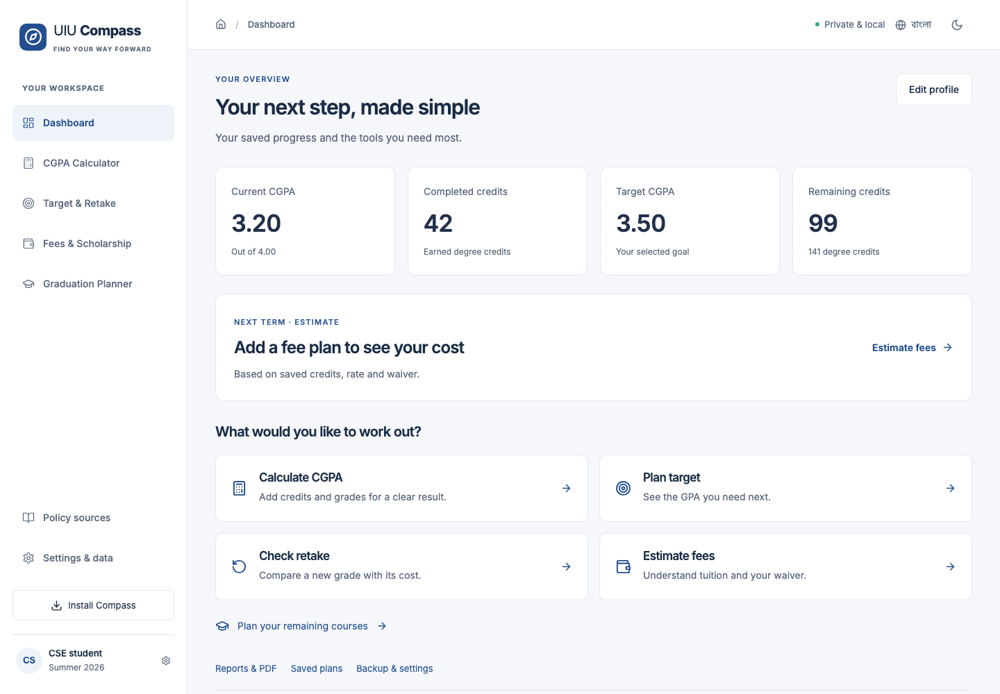
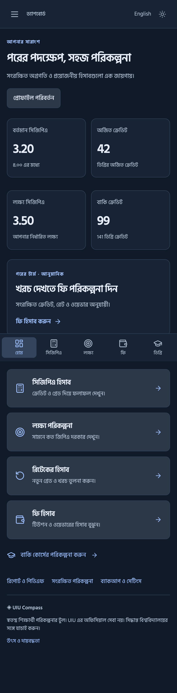

# UIU Compass

**Smart Academic & Financial Navigator** — a private, offline-capable React application for UIU students. Independent of United International University.

A local-first application organized into five primary destinations, with profile onboarding, course history, weighted GPA/CGPA, exact discrete-grade planning, retake combination search, tuition estimates, selected scholarship continuation checks, manual/partial-verified curricula, scenarios, print-to-PDF reports, backups, Bangla/English UI and dark mode.

## Run locally

Use Node 24 LTS (see `.nvmrc`; Node 21 is not supported by upstream tooling).

```sh
npm ci
npm run dev
```

Open the printed local URL, normally http://127.0.0.1:5173. No API keys, backend, account or environment variables are required. Start with **Find my way forward**, then choose quick totals or detailed course history. Empty defaults are intentional: no invented student records are preloaded.

## Verify

```sh
npm run typecheck
npm run lint
npm test
npm run build
npx playwright install chromium
npm run test:e2e
```

Browser tests serve the production build at port 4173, including service-worker/offline checks. Unit tests separate sourced grade fixtures from explicit hypothetical policy fixtures. CI runs these checks on Node 24. See `COMPLETION_REPORT.md` for actual execution results and scope limitations.

## Product map

| Page           | Working behavior                                                                                                                                           |
| -------------- | ---------------------------------------------------------------------------------------------------------------------------------------------------------- |
| Home           | Product overview and onboarding                                                                                                                            |
| Dashboard      | Saved-profile GPA, target, degree progress, fee estimate and projection                                                                                    |
| CGPA           | Quick weighted projection; detailed add/edit/delete/copy course history; term/cumulative charts and grade distribution                                     |
| Target         | Per-term credit/GPA scenarios, feasibility and exact discrete grade combinations                                                                           |
| Retakes        | Explicit highest/latest/all-attempt assumptions, minimum letter grade, up to 1,024 candidate subsets, four ranking goals                                   |
| Tuition        | Per-credit input or advertised estimate; tuition-only waiver; first-retake concession; excluded credits; integer-paisa breakdown and personal installments |
| Scholarships   | Selected Spring 2025+ categories, credit/GPA checks and protection forecast; no award certification                                                        |
| Graduation     | Manual requirements, verified eight-course CSE subset, prerequisites, selectable electives and term-load sequencing                                        |
| Scenarios      | Named saved snapshots, assumptions and academic/cost comparison                                                                                            |
| Reports        | Print-ready summary; browser Print → Save as PDF supports Bangla; ID omitted by default                                                                    |
| Settings       | Language, theme, validated JSON backup/restore, explicit replacement/deletion confirmation                                                                 |
| Policy sources | Versioned source URLs, scope, dates, verification and limitations                                                                                          |

## Policy trust model

Read [UIU_POLICY_RESEARCH.md](UIU_POLICY_RESEARCH.md) before editing rules. Most official pages rejected direct requests; the register identifies verification from indexed content of official URLs. This does not establish individual eligibility.

- Grade points: A 4.00, A− 3.67, B+ 3.33, B 3.00, B− 2.67, C+ 2.33, C 2.00, C− 1.67, D+ 1.33, D 1.00, F 0.
- Retake academic replacement is **not verified**. Repeated histories have no cumulative result until an explicit simulation rule is selected.
- I/W are excluded provisionally and prominently labeled; no automatic I→F conversion.
- First repeat/retake tuition concession is 50% from Fall 2024; later attempts do not automatically receive it. Mixed effective-period histories require confirmation.
- Current advertised tuition is **not** an old-batch tariff. Confirm manual rates using the student's ledger.
- CSE Summer 2026+ has 141 required credits. Eight verified rows are bundled, clearly labeled partial; all other requirements must be entered from an approved plan.
- Full historical curriculum, equivalency and scholarship catalogs remain outside verified coverage.

## Calculation conventions

Academic calculations preserve intermediate precision and display two decimals. GPA uses denominator credits, not necessarily earned degree credits. Unique passing course codes count once toward earned credits. Excluded rows are excluded from all totals. Term order follows first appearance in history. Quick mode assumes new courses not already included in previous totals and refuses explicit retake rows.

No-retake target: `(target * (existingCredits + newCredits) - currentCGPA * existingCredits) / newCredits`. Zero future credits yields no required-average value. Above 4.00 is infeasible. Discrete planning searches actual UIU grade points over 1–10 courses; it rejects state spaces above 200,000 unique totals rather than approximating silently.

Retake input baselines must be internally consistent with old grades. Candidate subsets are exact up to 10 courses. “Minimum future GPA” is a conditional ranking, not a promise. Minimum individual retake grades exclude future courses; the combination table includes them. Costs in saved target scenarios are new-course tuition; saved retake scenarios show additional retake tuition only. Read scopes before comparing.

Money uses integer paisa. Rates and credits support two decimal places; each line rounds once to the nearest paisa. One waiver applies only to eligible regular tuition. First-retake concessions are separate and do not stack the general tuition waiver onto retake tuition. Payments can yield a negative balance (credit). The installment planner is personal planning, not an official deadline calculator.

## Architecture

```text
src/
  domain/        Pure academic, finance, curriculum engines and TypeScript models
  policy/        Versioned official-source register and partial curriculum
  state/         React context, strict backup validation, storage, selectors
  components/    Shared controls, charts, PWA lifecycle, keyboard focus
  pages/         Route-level UI, lazy loaded
  styles.css     Responsive design, theme, print layout, reduced motion
public/          Icons, SPA redirects, security headers
 tests/          Vitest/RTL fixtures and Playwright journeys
```

There are no server calls for student data. The service worker caches only bundled application assets. Student records live in localStorage under `uiu-compass:v1`; backups validate and reconstruct known fields instead of trusting arbitrary properties. Rendering uses React text escaping; imported content is never injected as HTML. Browser storage is not encrypted. It can be lost; shared browser profiles can expose records. Export backups privately.

## Cloudflare Pages via GitHub

Private repository: https://github.com/MSHLIKHON/uiu-compass. The repair release is prepared locally; the final remote push and any public deployment require owner approval.

1. The private `MSHLIKHON/uiu-compass` repository has been created. Review the release and decide the license before any public publication.
2. Initialize this **app folder**, not its parent project mirror:

   ```sh
   git init -b main
   git add .
   git commit -m "Build UIU Compass academic and financial planner"
   git remote add origin https://github.com/MSHLIKHON/uiu-compass.git
   git push -u origin main
   ```

3. Cloudflare dashboard → Workers & Pages → Create → Pages → Connect to Git → select the repository.
4. Production branch `main`; build command `npm run build`; output `dist`; Node version `24` (set `NODE_VERSION=24` if required); no other environment variables.
5. If the repository contains this app as a subfolder, set root directory to `uiu-compass`. For a repository containing only app files, leave root blank.
6. Deploy after approval. `public/_redirects` provides SPA fallback; headers are copied into `dist`.
7. Test the HTTPS URL: direct `/target` load, refresh, install, first online visit then offline reload, saved data, update prompt. A secure origin is required for installation except localhost.
8. Subsequent authorized pushes trigger GitHub CI and Pages deployments. Enable branch protection to require CI before merging; do not assume Pages waits for a separate GitHub workflow unless configured accordingly.

Alternative Netlify: import the same repository; `netlify.toml` specifies build, output, Node and redirects. Review current hosting plan limits before publishing.

## PWA and reports

Production builds generate a manifest, 192/512 PNG icons including a maskable icon, and a versioned Workbox asset cache. Updates prompt before reload; unsaved form drafts should be saved first. Core routes are precached. External policy pages require internet. No native iOS/Android feature claims are made. iOS: Safari → Share → Add to Home Screen. Android/desktop: supported browser's Install control.

Reports use the browser print engine, not an external PDF service. **Print / Save PDF** → **Save as PDF**. Disable browser headers/footers if desired. This preserves system Bangla glyph rendering and keeps all records local. Report content is a saved-state snapshot; save calculator scenarios and the fee plan first.

## License and contribution

MIT is recommended for application source, subject to the owner's choice. No license grant is asserted until the owner adopts a license. Official policy material and university names are not relicensed. See [CONTRIBUTING.md](CONTRIBUTING.md).

> UIU Compass is an independent student-developed planning tool and is not an official United International University service. Verify academic and financial decisions with the university.

## Screenshots

These screenshots use hypothetical QA data.





## Repair release

Blank numeric fields remain blank and suppress unavailable results; genuine zero GPA remains valid. Course drafts update quick and detailed projections immediately. Fees and scholarship savings use current inputs, and graduation progress accepts editable totals. The schema and local-storage key are unchanged. Advanced tools remain in expandable sections. Inter and Hind Siliguri are bundled for offline typography.

The five primary destinations are Dashboard, CGPA Calculator, Target CGPA & Retake, Fees & Scholarship, and Graduation Planner. Existing secondary routes remain accessible. See `REPAIR_REPORT.md` for current validation and release status; `COMPLETION_REPORT.md` documents the original baseline.
